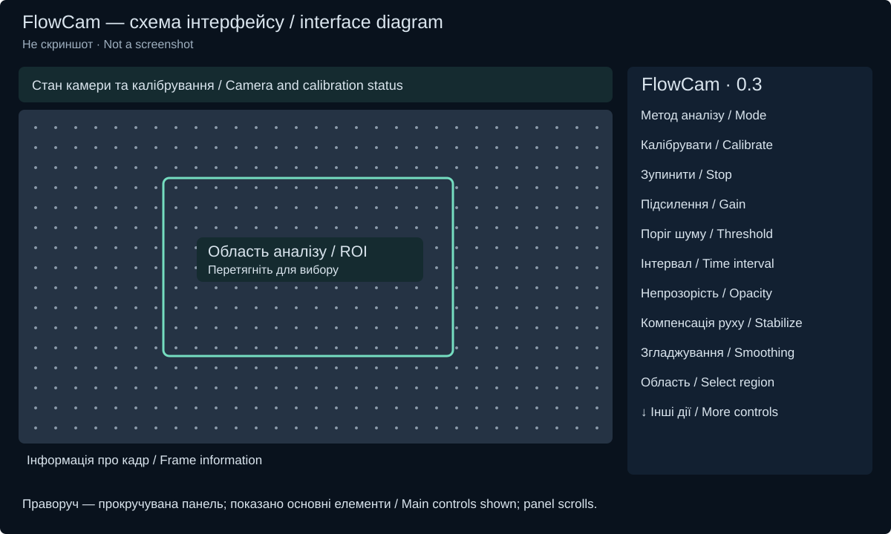
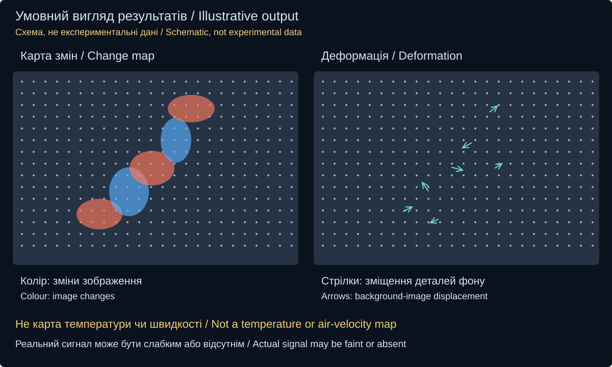

# FlowCam: інструкція

[English](USER_GUIDE.en.md) · [Опис проєкту](../README.md)

## Перший дослід

1. Встановіть отриманий APK FlowCam на сумісний Android-пристрій (Android 11+, arm64), дозвольте доступ до камери. APK поки не опублікований у GitHub Releases; збірка з коду описана в [технічній інструкції](DEVELOPMENT.md). Поточна версія — експериментальна.
2. Закріпіть телефон горизонтально. Поставте позаду майбутнього струменя нерухомий деталізований фон, наприклад друкований контрастний рисунок. Між камерою та фоном має проходити нагріте повітря. Не спрямовуйте гарячий струмінь на телефон чи фон. Монітор може створювати мерехтіння й муар; для першої перевірки краще паперовий фон.
3. Забезпечте рівномірне стабільне освітлення. У «Камера та фокус» добийтеся різкого зображення фону. Доступні ручні параметри залежать від камери.
4. При вимкненому фені ввімкніть «Вибрати область пальцем» і обведіть область спостереження. Залиште навколо неї нерухомі деталі поза струменем: вони потрібні для компенсації руху.
5. Виберіть «Зміни відносно еталона», підсилення ×8 і поріг 2.0 σ. Залиште компенсацію руху та помірне згладжування ввімкненими. Натисніть «Калібрувати» й дочекайтеся готового еталона. Камера і сцена мають залишатися нерухомими.
6. Перевірте фон без нагрівання. Потім увімкніть гаряче повітря, не переміщуючи камеру чи предмети. Порівняйте ділянку струменя з оточенням і повторіть перевірку після вимкнення.
7. Якщо контрольний фон спокійний, поступово підвищуйте підсилення. Воно робить сигнал помітнішим, але не збільшує фізичну чутливість камери. Нижчий поріг пропускає більше слабких змін і шуму.

## Інтерфейс

Ліворуч — відео з накладанням та область аналізу; вгорі — стан камери/калібрування, внизу — інформація про обробку. Праворуч розташована прокручувана панель керування. Схема скорочена; розміри елементів на телефоні можуть відрізнятися.

| Елемент | Призначення |
|---|---|
| Зміни відносно еталона | Порівняння з нерухомою сценою, записаною під час калібрування. |
| Зміни за інтервал часу | Порівняння кадрів, розділених часовим інтервалом; фактичний крок залежить від доступних кадрів. |
| Деформація · експеримент | Локальні зміщення деталей фону відносно еталона. |
| Калібрувати / Зупинити | Почати калібрування / зупинити аналіз або повтор. |
| Підсилення / Поріг шуму | Видимість сигналу / відсікання змін відносно оціненого шуму. |
| Часове порівняння | Бажаний мінімальний інтервал для часового режиму. |
| Непрозорість / Без накладання | Прозорість карти / перегляд самого відео. |
| Компенсувати рух камери | Компенсація невеликих зсувів за контрольними деталями; не замінює штатив. |
| Помірне згладжування | Зменшення дрібного шуму. Зміна фільтра потребує нового еталона. |
| Вибрати область пальцем | Вибір ділянки перетягуванням на зображенні. |
| Камера та фокус | Параметри доступної камери. |
| Діагностика та інструкція | Технічний стан і допомога. |

## Приблизний вигляд результату

Кольорові плями показують зміни зображення відносно порівнюваного кадру. Це не температура і не швидкість. У режимі деформації стрілки показують локальні зміщення деталей фону в пікселях; для видимості їхня довжина збільшена у 10 разів. Їхній напрямок не слід читати як напрямок руху повітря.

У реальному досліді карта може бути слабкою, фрагментарною або порожньою. Порожня карта не доводить відсутність потоку. Рух предметів, зміни освітлення і мерехтіння теж можуть давати сигнал. Холодний потік без достатніх неоднорідностей показника заломлення може залишатися невидимим.

## Запис і повтор

- «Запис досліду · до 10 с» зберігає короткий дослід; ліміт — до 8 кадрів/с і 40 MiB, тому запис іноді завершується раніше.
- «Повторити останній» відкриває збережені кадри для повторної обробки. Це не всі кадри живого перегляду: часовий результат може відрізнятися.
- «Зберегти дані .air» створює окрему копію для повторного аналізу; «Відкрити дослід .air» завантажує її.
- «Експорт відео MP4» створює відео для перегляду. Для повторних обчислень зберігайте також `.air`.
- «Зупинити» під час повтору повертає живу камеру. Після повернення з іншого застосунку або вибору файла виконайте нове калібрування.

## Якщо результат незрозумілий

**Зміни по всьому кадру:** перевірте освітлення, вібрації, автофокус, мерехтіння монітора та контрольні ділянки поза струменем; відкалібруйте повторно.

**Майже нічого не видно:** перевірте різкість і деталізацію фону, перетин гарячим струменем лінії зору та контроль без нагрівання. Лише після цього збільшуйте підсилення.

**Немає стрілок:** алгоритм міг не знайти достатньо надійних зміщень. Не знижуйте критерії лише заради появи стрілок.

Точність вимірювання реального потоку та продуктивність поточної версії на S25 Ultra ще не підтверджені контрольованими фізичними випробуваннями.
